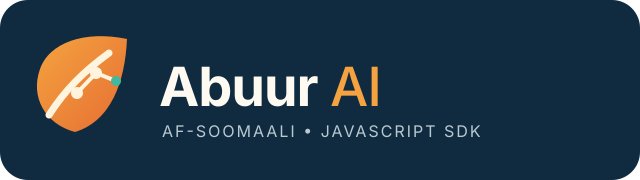

<p align="center">
  
</p>

# Abuur AI

Abuur AI waa SDK JavaScript ah oo Af-Soomaali mudnaan siiya, kaas oo hal API
isku mid ah ugu dira codsiyada qoraalka 12 adeeg AI ah. Habaynta iyo hawlaha
waxay adeegsadaan magacyo Af-Soomaali ah, iyadoo xogta adeegga, moodelka,
codsiga, iyo jawaabta loo hayo horumariyeyaasha JavaScript iyo TypeScript.

Waxaad u adeegsan kartaa kaaliye Af-Soomaali ku hadla, turjumaad, qorista iyo
hagaajinta qoraalka, wada sheekaysi, ama codsi u baahan inuu adeeg AI beddelo
isagoon dib u qorin hawl kasta. Wuxuu ka shaqeeyaa Node.js 22+; gelitaanka
browser-ku wuxuu taageeraa Gemini, OpenRouter, Ollama, Perplexity, Meta, iyo
NVIDIA. Gelitaanka Node.js wuxuu intaas ku daraa OpenAI, Anthropic, Mistral,
DeepSeek, Cohere, iyo xAI.

Abuur AI wuxuu mideeyaa qaabka codsiyada qoraalka, balse adeeg-bixiyeyaashu
isku mid ma aha. Adeeg kasta ayaa go'aamiya helitaanka moodelka, kharashka,
xadka isticmaalka, tayada, iyo awoodaha. Adapter-rada ku jira xirmadu waxay
hirgeliyaan qoraal iyo qulqul qoraal; ma hirgeliyaan dhammaan awoodaha
multimodal, embeddings, ama wicitaanka qalabka. Awoodahaas waxay u baahan
yihiin adapter gaar ah oo waafaqsan. Tilmaamaha ku wajahan Af-Soomaaligu waa
hagitaan, mana dammaanad qaadaan turjumaad sax ah ama xog run ah.

## Tusmada

- [Rakibid iyo codsiga koowaad](#rakibid-iyo-codsiga-koowaad)
- [Dejinta deegaanka iyo ilaalinta furaha](#dejinta-deegaanka-iyo-ilaalinta-furaha)
- [Tixraaca habaynta](#tixraaca-habaynta)
- [Adeegyada iyo moodelada la taageero](#adeegyada-iyo-moodelada-la-taageero)
- [Tusaalooyin habaynta adeeg-bixiyaha](#tusaalooyin-habaynta-adeeg-bixiyaha)
- [Hawlaha qoraalka iyo tusaalooyinka](#hawlaha-qoraalka-iyo-tusaalooyinka)
- [Wada sheekaysi, qulqul, iyo joojin](#wada-sheekaysi-qulqul-iyo-joojin)
- [Doorashada adeeg iyo moodel](#doorashada-adeeg-iyo-moodel)
- [JSON, raadinta aqoonta, iyo adapter gaar ah](#json-raadinta-aqoonta-iyo-adapter-gaar-ah)
- [Isticmaalka iyo tirinta tokens](#isticmaalka-iyo-tirinta-tokens)
- [Tixraaca API-ga](#tixraaca-api-ga)
- [Browser iyo Node.js](#browser-iyo-nodejs)
- [Khaladaad iyo xalinta dhibaatooyinka](#khaladaad-iyo-xalinta-dhibaatooyinka)
- [TypeScript](#typescript)
- [Su'aalaha caanka ah](#suaalaha-caanka-ah)
- [Wax-ku-biirin, taageero, iyo shati](#wax-ku-biirin-taageero-iyo-shati)

## Rakibid iyo codsiga koowaad

```sh
npm install abuur-ai
```

Xirmadu waa ES module, server-kana wuxuu u baahan yahay Node.js 22 ama ka
cusub. Warshadda keliya ee dadweynaha waa `abuurAI()`:

```js
import { abuurAI } from "abuur-ai";

const ai = abuurAI({
  bixiye: "gemini",
  furahaAPI: process.env.GEMINI_API_KEY,
  moodel: "gemini-3.8-flash",
  tilmaamo: "Ku jawaab Af-Soomaali."
});

const jawaab = await ai.weydii("Salaan!");
console.log(jawaab.text);
```

`weydii()` waxay soo celisaa ballan (`Promise`) leh `AIResponse`: `text`,
`provider`, `model`, iyo `usage` marka adeeg-bixiyuhu bixiyo. Adeegga iyo
moodelka habaynta ayaa la adeegsadaa, ilaa codsigu adeeg kale doorto. SDK-gu
si qarsoodi ah uguma celiyo codsi fashilmay adeeg kale.

## Dejinta deegaanka iyo ilaalinta furaha

Furaha adeegga ku deji deegaanka server-ka ama deployment-ka. Abuur AI
iskama akhriyo faylasha `.env`. Mashruuca Node-ga waxaad si cad ugu soo
gelin kartaa `dotenv` (ikhtiyaari):

```sh
npm install dotenv
```

```js
import "dotenv/config";
import { abuurAI } from "abuur-ai";
```

Adeegso doorsoomaha deegaanka ee adeegga aad dooratay (miiska adeegyada ka
eeg). Ama sirta si toos ah ugu gudbi `furahaAPI`; adeegyo badan isticmaal
`providers.<id>.furahaAPI`. Waligaa furaha wax-soo-saarka ha gelin Git,
browser-ka, frontend bundle dadweyne, URL, ama logs. Codsiga browser-ka qof
kasta ayaa arki kara furihiisa. Furayaasha gaarka ah server ku hay, codsigana
u sii mari backend adigu maamusho oo la xaqiijiyo. Haddii furuhu bannaanka u
baxo, ka noqo oo mid cusub samee.

## Tixraaca habaynta

Magacyada Af-Soomaaliga ah ayaa lagu talinayaa; magacyada Ingiriisiga ee
waafaqsanaantu waa kuwo duugoobaya.

| Ikhtiyaar | Nooc | Qiimaha caadiga ah | Ma khasab baa? | Macnaha |
| --- | --- | --- | --- | --- |
| `bixiye` | `ProviderId` | `"gemini"` marka codsi u baahdo adeeg; habaynta guud ahaan `null` | Maya | Aqoonsiga adeegga caadiga ah. |
| `furahaAPI` | `string` | `null` | Adeegyada la martigeliyo; looma baahna Ollama maxalli ah | Furaha adeegga la doortay. |
| `moodel` | `string` | `null`; Gemini selector-ku wuxuu default ka dhigaa `gemini-2.5-flash` hirgelinta hadda | Adeegyada oo dhan moodel bay u baahan yihiin, marka laga reebo default-ka Gemini | Aqoonsiga moodelka saxda ah ee adeegga. Google hadda wuxuu default-ka ku tilmaamaa duugoobay/helitaankiisu xaddidan yahay. |
| `tilmaamo` | `string` | `null` | Maya | Tilmaamo guud oo lagu daro codsiyada qoraalka ee la taageero. Tilmaamaha hawsha ee qasabka ahi way ka mudnaan badan yihiin. |
| `cinwaankaAPI` | `string` | Endpoint-ka adeegga | Maya | Endpoint gaar ah; OpenRouter, Ollama, Perplexity, Meta, iyo NVIDIA ayaa adeegsada. Adapter-rada kale waxay leeyihiin endpoint go'an ama SDK adeeg-bixiye. |
| `providers` | `Partial<Record<ProviderId, ProviderConfig>>` | `{}` | Maya | Furaha, moodelka, endpoint, `fetch`, iyo awoodaha provider kasta; waxtar u leh `mode: "auto"`. |
| `mode` | `"manual" \| "auto"` | `"manual"` | Maya | `auto` wuxuu `doorModel()` u oggolaanayaa inuu doorto adeeg habaysan; codsiga fashilmay dib looma wareejiyo. |
| `language` | `string` | `"automatic"` | Maya | Tilmaanta luqadda; automatic-ku wuxuu moodelka farayaa inuu luqadda qoraalka raaco, iyadoo hagitaanka Af-Soomaaligu jiro. |
| `providerPreference` | `ProviderId[]` | `[]` | Maya | Kala horraynta guud ee doorashada automatic-ka. |
| `taskProviderPreferences` | `Partial<Record<ProviderTask, ProviderId[]>>` | `{}` | Maya | Kala horraynta hawlaha: `translation`, `summarization`, `writing`, `coding`, `reasoning`, `classification`, `conversation`. |
| `pricing` | `Record<string, ModelPricing \| Record<string, ModelPricing>>` | `{}` | Maya | Qiimeyaal aad dejiso si loo qiyaaso kharashka. |
| `fetch` | `typeof fetch` | `globalThis.fetch` ama default-ka SDK-ga adeeg-bixiyaha | Maya | Hirgelin Fetch oo gaar ah, tusaale tijaabo ama shabakad gaar ah. |

`ModelPricing` wuxuu ka kooban yahay `inputPerMillion` iyo
`outputPerMillion`. ProviderConfig-ku wuxuu intaas ku daraa
`capabilities: ProviderCapability[]`; waxay xaddidi kartaa awoodaha adapter
gaar ah, balse ma abuuri karto hab aan adapter-ku hirgelin.

Magacyada duugoobaya waa `provider`, `apiKey`, `model`, `instructions`,
`systemPrompt`; `endpoint` waa magacii hore ee `cinwaankaAPI`. Haddii magacyada
Somaliga iyo Ingiriisiga qiimayaal is khilaafsan leeyihiin, khalad baa la
soo celiyaa. Provider config-guna wuxuu aqbalaa aliases-ka hore `apiKey`,
`model`, iyo `endpoint`.

Furaha iyo moodelka guud waxay khuseeyaan adeegga la doortay oo keliya,
mana noqdaan furaha adeeg kale. Adeegyo badan ku habee `providers`. Habaynta
waa la hubiyaa marka la bilaabayo iyo marka hawsha khusayso la wacayo; helitaanka
moodelka adeeg-bixiyaha horay looma xaqiijiyo.

## Adeegyada iyo moodelada la taageero

Xirmadu waxay taageertaa 12 aqoonsi adeeg. Aqoonsiyada tusaalaha ah waxaa laga
xaqiijiyey liisaska rasmiga ah **3 Nofeembar 2026**; SDK-ga kuma jiraan waana
tusaalooyin keliya. Liisaska, aliases-ka, xaaladda tijaabada, xuquuqda akoonka,
iyo endpoints-ku way is beddeli karaan. Ka hubi liiska rasmiga ah iyo akoonkaaga
ka hor intaadan adeegga gelin. Adapter-ku inuu aqbalo xarig moodel ah ma
dammaanad qaadayo in moodelku weli jiro, akoonkaagu heli karo, ama awood kasta
la shaqayso.

| Adeeg / `bixiye` | Endpoint-ka adapter-ku adeegsado | Furaha iyo default-ka | Tusaalooyin moodel iyo liiska rasmiga ah |
| --- | --- | --- | --- |
| Google Gemini / `gemini` | Google GenAI SDK; browser-ku wuxuu adeegsadaa `generativelanguage.googleapis.com/v1beta/models/{model}:generateContent` | `GEMINI_API_KEY`; default-ka selector-ku waa `gemini-2.5-flash` (helitaankiisu wuu xaddidan yahay isticmaalayaasha cusub) | `gemini-3.8-flash`, `gemini-4-argon`; [liiska Google](https://ai.google.dev/gemini-api/docs/models) |
| OpenAI / `openai` | Responses API ee OpenAI SDK | `OPENAI_API_KEY`; default ma jiro | `gpt-6-astra`, `gpt-6.1-sol`, `gpt-6-luna`; [liiska OpenAI](https://developers.openai.com/api/docs/models) |
| Anthropic / `anthropic` | `https://api.anthropic.com/v1/messages` | `ANTHROPIC_API_KEY`; default ma jiro | `claude-opus-5-5`, `claude-sonnet-5-5`, `claude-haiku-5-5`; [dulmar moodelada Anthropic](https://platform.claude.com/docs/en/models/overview) |
| Mistral / `mistral` | `https://api.mistral.ai/v1/chat/completions` | `MISTRAL_API_KEY`; default ma jiro | `mistral-large-4`, `mistral-small-4`; [moodelada Mistral](https://docs.mistral.ai/models/) |
| DeepSeek / `deepseek` | `https://api.deepseek.com/chat/completions` | `DEEPSEEK_API_KEY`; default ma jiro | `deepseek-flash`, `deepseek-v4-pro`; [moodel iyo qiime DeepSeek](https://api-docs.deepseek.com/quick_start/pricing) |
| Cohere / `cohere` | `https://api.cohere.com/v2/chat` | `COHERE_API_KEY`; default ma jiro | `command-a-plus-05-2026`, `command-a-03-2025`, `command-a-reasoning-08-2025`; [liiska Cohere](https://docs.cohere.com/v2/docs/models) |
| xAI / `xai` | `https://api.x.ai/v1/chat/completions` | `XAI_API_KEY`; default ma jiro | `grok-4.7`, `grok-4.6`, `grok-4.5`; [liiska xAI](https://docs.x.ai/developers/models) |
| OpenRouter / `openrouter` | `https://openrouter.ai/api/v1/chat/completions` | `OPENROUTER_API_KEY`; default ma jiro | `openai/gpt-4o` (qaabka: `provider/model`); [liiska OpenRouter](https://openrouter.ai/models) |
| Ollama / `ollama` | Default maxalli ah `http://localhost:11434/v1/chat/completions`; waa la habayn karaa | Furaha looma baahna Ollama maxalli ah; `OLLAMA_API_KEY` waa ikhtiyaari (cloud); default moodel ma jiro | `llama3.2`, `llama3.2:1b`, `gemma4:31b`; [maktabadda Ollama](https://ollama.com/library) |
| Perplexity / `perplexity` | `https://api.perplexity.ai/chat/completions` | `PERPLEXITY_API_KEY`; default ma jiro | `sonar` (aqoonsiga hore ee Sonar Chat Completions); [dukumentiga guuritaanka Perplexity](https://docs.perplexity.ai/docs/agent-api/migrate-from-sonar/overview) |
| Meta Model API / `meta` | `https://api.meta.ai/v1/chat/completions` (Chat Completions waafaqsan OpenAI) | `META_API_KEY`; default ma jiro | `muse-spark-1.3`, `muse-wonder-1.0`; [moodelada Meta Model API](https://dev.meta.ai/docs/models) |
| NVIDIA NIM / `nvidia` | `https://integrate.api.nvidia.com/v1/chat/completions` | `NVIDIA_API_KEY`; default ma jiro | `deepseek-ai/deepseek-v4-pro`, `meta/llama-3.3-70b-instruct`, `mistralai/mixtral-8x7b-instruct`; [liiska NVIDIA NIM](https://docs.api.nvidia.com/nim/reference/llm-apis) |

Dhammaan adeegyada marka laga reebo Ollama maxalli ah waxay u baahan yihiin
furaha API. Adapter-rada Node-ka iyo HTTP-ga browser-ka qaarkood waxay
taageeraan qoraal iyo SSE streaming. Adapter-ka Gemini ee browser-ku qoraal
ayuu sameeyaa oo keliya; streaming ma taageero.

Faahfaahinta moodelada:

- **Gemini:** Adeegso aqoonsi API oo hadda jira sida `gemini-3.8-flash`.
  Default-ka ku jira hirgelinta `gemini-2.5-flash` waa duugoobay, gelitaankiisuna
  isticmaalayaasha cusub wuu xaddidan yahay; moodel cusub si cad u dooro.
- **OpenAI:** Adapter-ku wuxuu adeegsadaa Responses API; moodelka waa inuu
  taageeraa API-gaas, tusaale ahaan `gpt-6.1-sol`.
- **Anthropic:** Adeegso aqoonsiga Claude API, ha adeegsan magaca suuq-geynta.
  Adapter-ku wuxuu u diraa Messages API oo `max_tokens: 1024` go'an leh.
- **Mistral:** Moodelada iyo helitaankoodu waxay ku xiran yihiin akoonka;
  adapter-ku wuxuu filayaa qaabka Chat Completions ee Mistral.
- **DeepSeek:** Ka eeg aqoonsiyada liiska rasmiga ah. Codsiga SDK-gu waa
  Chat Completions caadi ah; ma diro dejin gaar ah oo thinking/reasoning ah.
- **Cohere:** Adapter-ku wuxuu adeegsadaa Cohere v2 Chat. Ma hirgeliyo Rerank,
  Embed, Parse, ama transcription API-yada Cohere.
- **xAI:** Adeegso aqoonsi qoraal/chat oo liiska xAI ku jira.
- **OpenRouter:** Aqoonsigu waa slug-ka buugga moodelada, badanaa
  `provider/model`, ma aha magaca moodelka oo keliya. Ka raadi
  [openrouter.ai/models](https://openrouter.ai/models) ama isticmaal
  `GET /api/v1/models`; hubi inuu moodelku taageero Chat Completions.
- **Ollama:** Ku rakib Ollama, soo dejiso moodel, oo bilow adeeggiisa:

  ```sh
  ollama pull llama3.2
  ollama serve
  ```

  Deji `bixiye: "ollama"` iyo `moodel: "llama3.2"`. Endpoint-ka caadiga ahi
  waa `http://localhost:11434/v1`; wuxuu adeegsadaa API-ga OpenAI-compatible.
  Ku beddel `cinwaankaAPI`, `OLLAMA_ENDPOINT`, ama `OLLAMA_HOST`. Adeegga
  maxalliga ahi furaha uma baahna. Cloud-ka Ollama wuxuu adeegsan karaa
  `OLLAMA_API_KEY` iyo `cinwaankaAPI: "https://ollama.com/v1"`; helitaanka
  moodelada cloud-ka Ollama ayaa maamula.
- **Perplexity:** Adapter-kan wuxuu adeegsadaa Sonar Chat Completions-kii hore.
  Perplexity wuxuu sheegay in taageerada Sonar Chat Completions dhammaanayso
  27 Sebtembar 2026, wuxuuna ku talinayaa Agent API-ga cusub. Noocan SDK-ga
  Agent API-ga ma hirgeliyo; codsiyada synchronous iyo streaming-ga hore
  waxaa laga yaabaa in loo beddelo qaab cusub. U arag is-dhexgal ku-meel-gaar
  ah oo xaqiiji ka hor ku-tiirsanaanta.
- **Meta:** Waa Meta Model API-ga rasmiga ah ee `api.meta.ai`, furihiisana
  waxaa laga abuuraa dashboard-ka Meta Model API. Wuxuu adeegsanayaa
  `/v1/chat/completions` oo OpenAI-compatible ah. `muse-spark-1.3` iyo
  `muse-wonder-1.0` waa aqoonsiyada Meta Model API. Ma aha adeegga chat-ka
  macaamiisha ee Meta AI; sidoo kale wuu ka duwan yahay Llama maxalli ahaan
  Ollama loogu socodsiiyo ama Llama cid saddexaad ka martigeliso OpenRouter.
- **NVIDIA:** Waa adeegga inference-ka NVIDIA NIM ee la martigeliyo, mana aha
  NVIDIA SDK ama CUDA maxalli ah. Adeegso slug-ka saxda ah ee liiska NIM.
  NIM aad adigu martigeliso waxaa loo jeedin karaa `cinwaankaAPI` haddii uu
  taageero isla qaabka Chat Completions.

## Tusaalooyin habaynta adeeg-bixiyaha

### Adeeg kale oo la martigeliyo

Adapter kasta wuxuu u baahan yahay moodel iyo fure u gaar ah:

```js
const ai = abuurAI({
  bixiye: "openai",
  furahaAPI: process.env.OPENAI_API_KEY,
  moodel: "gpt-6.1-sol"
});
console.log((await ai.weydii("Explain photosynthesis.")).text);
```

### Moodel OpenRouter ah

Gudbi slug-ka buuxa ee liiska OpenRouter:

```js
const ai = abuurAI({
  bixiye: "openrouter",
  furahaAPI: process.env.OPENROUTER_API_KEY,
  moodel: "openai/gpt-4o"
});
```

### Endpoint gaar ah

`cinwaankaAPI` waxaa adeegsada OpenRouter, Ollama, Perplexity, Meta, iyo
NVIDIA. Geli waddada saxda ah ee endpoint-ka:

```js
const ai = abuurAI({
  bixiye: "openrouter",
  furahaAPI: process.env.OPENROUTER_API_KEY,
  moodel: "openai/gpt-4o",
  cinwaankaAPI: "https://openrouter.ai/api/v1/chat/completions"
});
```

### Ollama maxalli ah ama cloud

Bilow Ollama maxalli ah, kana soo dejiso moodel sida kor ku cad:

```js
const maxalli = abuurAI({ bixiye: "ollama", moodel: "llama3.2" });
console.log((await maxalli.weydii("Ku jawaab Af-Soomaali: Salaan.")).text);
```

Cloud-ka Ollama furaha iyo endpoint-ka si cad u deji:

```js
const cloud = abuurAI({
  bixiye: "ollama",
  furahaAPI: process.env.OLLAMA_API_KEY,
  moodel: "gemma4:31b-cloud",
  cinwaankaAPI: "https://ollama.com/v1"
});
```

## Hawlaha qoraalka iyo tusaalooyinka

Dhammaan hawlaha qoraalku waxay soo celiyaan `Promise<AIResponse>`. Ikhtiyaarka
ugu dambeeya wuxuu qaadan karaa `bixiye`, `moodel`, `tilmaamo`, iyo `language`.
Moodelka la doortay ayaa qabta qoraalka.

```js
const ai = abuurAI({
  bixiye: "gemini",
  furahaAPI: process.env.GEMINI_API_KEY,
  moodel: "gemini-3.8-flash",
  tilmaamo: "Ku jawaab Af-Soomaali."
});

console.log((await ai.weydii("Waa maxay AI?")).text);
console.log((await ai.turjun("Good morning!", "Somali")).text);
console.log((await ai.sooKoob("Qoraal dheer oo la soo koobayo...")).text);
console.log((await ai.sharax("Explain the water cycle.")).text);
console.log((await ai.sax("Somalia are a beautiful country.")).text);
console.log((await ai.dibUqor("Rewrite this more clearly.")).text);
console.log((await ai.hagaaji("Improve this paragraph.")).text);
console.log((await ai.balaadhi("Expand this short idea.")).text);
console.log((await ai.qor("Write a polite appointment email.")).text);
console.log((await ai.curi("Create an original short story about a camel.")).text);
console.log((await ai.fikrado("Low-cost community projects")).text);
console.log((await ai.cinwaan("An article about Somali poetry")).text);
console.log((await ai.sameeSuaalo("A lesson about solar energy")).text);
console.log((await ai.falanqee("Review this argument: ...")).text);
console.log((await ai.kalaSaar("The delivery arrived late.", ["positive", "negative", "neutral"])).text);
console.log((await ai.dareen("I am delighted with the result.")).text);
console.log((await ai.sooSaarXog("Extract the date and location: ...")).text);
console.log((await ai.isbarbarDhig(["Option A details", "Option B details"])).text);
console.log((await ai.qorCode("Write a JavaScript function that adds two numbers.")).text);
console.log((await ai.sharaxCode("const total = prices.reduce((a, b) => a + b, 0);")).text);
console.log((await ai.saxCode("const x = ;")).text);
console.log((await ai.dibUhabeeCode("function f(x){return x+1}")).text);
```

Codsi kasta waxaad ku dooran kartaa adeeg ama tilmaamo gaar ah:

```js
const jawaab = await ai.weydii("What is photosynthesis?", {
  bixiye: "openrouter",
  moodel: "openai/gpt-4o",
  tilmaamo: "Si fudud ugu sharax Af-Soomaali."
});
const turjumaad = await ai.turjun("Subax wanaagsan.", "English", {
  language: "English"
});
```

`moodel` wuxuu ku jiraa nooca ikhtiyaarka codsiga dadweynaha, laakiin ma beddelo
adapter horay loo bilaabay. Moodelka ku deji `moodel` guud ama
`providers.<id>.moodel`.

## Wada sheekaysi, qulqul, iyo joojin

Taariikhda wada sheekaysiga waxaa lagu hayaa xusuusta macmiilka, adeeg walbana
si gaar ah. `wadaSheekeysi()` wuxuu bilaabaa taariikh; `siiWad()` wuxuu u baahan
yahay farriin hore. `nadiifi()` wuxuu tirtiraa taariikh adeeg ama dhammaan:

```js
await ai.wadaSheekeysi("Aan ka hadalno beeraha.");
const xigta = await ai.siiWad("Maxay waraabintu muhiim u tahay?");
ai.nadiifi();
```

`qulqul()` wuxuu soo saaraa `AIStreamChunk`; badanaa waxaa ku jira qaybta
qoraalka `text`, mararka qaarna qaybta ugu dambaysa ee `usage`:

```js
for await (const chunk of ai.qulqul({ prompt: "Sheeg sheeko gaaban." })) {
  if (chunk.text) process.stdout.write(chunk.text);
}
```

Codsiyada taageera waxaad ku joojin kartaa `AbortSignal`:

```js
const controller = new AbortController();
const pending = ai.weydii("Write a long answer.", { signal: controller.signal });
setTimeout(() => controller.abort(), 100);
try {
  await pending;
} catch (error) {
  if (error.name === "AbortError") console.log("Codsiga waa la joojiyey.");
  else throw error;
}
```

`qulqul({ prompt, signal })` isna wuu aqbalaa signal. Joojintu waxay ku xiran
tahay habka adeeg-bixiyaha; SDK-gu ma dammaanad qaado in lacag-bixintu isla
markaas joogsato. Hababka qoraalka guud iyo wada sheekaysigu signal-ka ma sii
mariyaan.

HTTP adapter-radu waxay adeegsadaan SSE; OpenAI/Gemini-na stream SDK-gooda.
Gemini browser adapter-ku ma taageero qulqul. Buffering, moodel taageero,
iyo dhacdooyinka ugu dambeeya ee usage way kala duwanaan karaan.

## Doorashada adeeg iyo moodel

Adeegyo badan ku habee `mode: "auto"`. Adeeg kasta oo la martigeliyo wuxuu u
baahan yahay furihiisa iyo moodelkiisa. Ollama maxalli ahi moodel ayuu u baahan
yahay, balse furaha uma baahna.

```js
const ai = abuurAI({
  mode: "auto",
  providers: {
    gemini: { furahaAPI: process.env.GEMINI_API_KEY, moodel: "gemini-3.8-flash" },
    openai: { furahaAPI: process.env.OPENAI_API_KEY, moodel: "gpt-6.1-sol" }
  },
  providerPreference: ["gemini", "openai"],
  taskProviderPreferences: { coding: ["openai", "gemini"] }
});

const doorasho = ai.doorModel({ task: "coding" });
console.log(doorasho.provider, doorasho.model);
const jawaab = await ai.weydii("Write a small parser.", { bixiye: doorasho.provider });
```

Hawlaha la aqbalo: `translation`, `summarization`, `writing`, `coding`,
`reasoning`, `classification`, `conversation`. `doorModel()` sidoo kale wuxuu
aqbalaa `task`, `preferredProvider`, `allowedProviders`, `allowedModels`,
`capability`, iyo `requiredCapabilities`. Wuxuu soo celiyaa xog doorasho,
mana diro codsi moodel. `awoodahaModelka()` wuxuu sheegaa awoodaha adapter-ka,
mana xaqiijiyo helitaanka moodelka ama akoonka.

Habka caadiga ah provider-ku waa Gemini. Codsi kasta `bixiye` ayuu ku dooran
karaa adapter la habayn karo. Habka `auto`, adeegga codsiga waa in horay loo
habbeeyey. Midkoodna si qarsoodi ah uguma wareejiyo codsi fashilmay.

## JSON, raadinta aqoonta, iyo adapter gaar ah

Adapter-rada caadiga ahi waxay hadda bixiyaan qoraal iyo qulqul qoraal.
JSON habaysan, embeddings, warbaahin, ogaanshaha lahjad, iyo wicitaanka
qalabka agent-ku waxay u baahan yihiin adapter gaar ah oo lagu diiwaangeliyo
`ai.providers.register()`. Awood aan la taageerin khalad bay keentaa.

### JSON habaysan oo leh adapter gaar ah

```js
const structured = abuurAI({ bixiye: "custom" });
structured.providers.register("custom", {
  capabilities: ["structured-output"],
  generateStructured: async () => ({ data: { name: "Ayaan", age: 20 } })
});
const xog = await structured.sooSaarJSON({
  prompt: "Return a name and age.",
  schema: {
    type: "object",
    properties: { name: { type: "string" }, age: { type: "integer" } },
    required: ["name", "age"],
    additionalProperties: false
  }
});
console.log(xog.data);
```

SDK-gu wuxuu parse-gareeyaa JSON xarig ah, wuxuuna ku hubiyaa qaybta JSON
Schema uu taageero. Adapter-ku waa inuu hirgeliyaa `generateStructured`.

### Raadinta aqoonta

Raadinta lexical-ku waxay qoraalka u kala jartaa qaybo, waxayna ku kala
horraysaa is-waafajinta erayada; kadib waxay qoraalka la helay u dirtaa
moodelka. Ha dirin xog sir ah haddii aan laguu oggolayn:

```js
const natiijo = await ai.raadsoAqoon({
  question: "What does this note say about water?",
  documents: [
    { id: "field-notes", content: "Clean water supports healthy communities." }
  ],
  limit: 4
});
console.log(natiijo.answer, natiijo.sources);
```

Default-ku waa `lexical`, qaybaha 1200 xaraf, is-dulsaarka 160 xaraf, ugu badnaanna
4 natiijo. Habka `semantic` wuxuu u baahan yahay adapter embeddings iyo
`embeddingModel` cad; `vectorStore` ikhtiyaari ah waa inuu hirgeliyaa
`search(vector, options)`, sidoo kale `upsert(records, options)` haddii
`indexDocuments: true`.

### Agent iyo qalab la diiwaangeliyey

`wakiilAI()` wuxuu u baahan yahay adapter gaar ah oo leh `generateWithTools`
iyo awoodda `tool-calling`. Qalabka si cad ayaa loo siiyaa, schema ayaa laga
hubiyaa, app-kuna gudaha ayuu ka fuliyaa:

```js
const agent = abuurAI({ bixiye: "custom" });
agent.providers.register("custom", {
  capabilities: ["tool-calling"],
  generateWithTools: async ({ step }) => step === 1
    ? { toolCall: { name: "lookup", arguments: { topic: "Somalia" } } }
    : { finalAnswer: "The lookup completed." }
});
const natiijo = await agent.wakiilAI({
  task: "Look up a topic",
  tools: [{
    name: "lookup",
    schema: {
      type: "object",
      properties: { topic: { type: "string" } },
      required: ["topic"],
      additionalProperties: false
    },
    execute: async ({ topic }) => `Result for ${topic}`
  }]
});
console.log(natiijo.answer);
```

Xuduudaha agent-ka: `maxSteps` default-ku waa 5 (1–10); `maxExecutionMs`
default-ku waa 30000 (1–120000). Waxaa kale oo la siin karaa `signal`,
`approve`, iyo `memory` JSON-compatible ah. Waa wareeg uu SDK-gu maamulo,
ma aha awood ku dhex jirta provider kasta.

## Isticmaalka iyo tirinta tokens

Codsiyada client-ka waa la tiriyaa. `cabirIsticmaalka()` wuxuu soo celiyaa
tirada codsiyada, muddada, provider/model, iyo tokens haddii adeeggu soo sheego.
Kharashka waxaa la qiyaasaa oo keliya haddii qiime cad la dejiyo:

```js
const laTiriyey = abuurAI({
  bixiye: "gemini",
  furahaAPI: process.env.GEMINI_API_KEY,
  moodel: "gemini-3.8-flash",
  pricing: { gemini: { inputPerMillion: 0.1, outputPerMillion: 0.4 } }
});
await laTiriyey.weydii("Salaan!");
console.log(laTiriyey.cabirIsticmaalka());
console.log(laTiriyey.cabirIsticmaalka({ reset: true }));
```

Qiimayaashu tusaale uun bay yihiin; adeegso qiimaha hadda ee provider/model-ka.
Tokens waa tiro dhab ah oo keliya haddii adeeg-bixiyuhu soo sheego. Kharashka
iyo usage laguma ballanqaadayo jawaab kasta.

## Tixraaca API-ga

### Hababka qoraalka iyo wada sheekaysiga (24)

Dhammaantood waxay soo celiyaan `Promise<AIResponse>`, marka laga reebo
`nadiifi()`. Hababka qoraalku waxay qaataan xarig aan madhnayn iyo
`AIRequestOptions` ikhtiyaari ah. Jawaabtu waxay leedahay `text`, `provider`,
`model`, `usage` ikhtiyaari ah, iyo xog kale oo adeeg-bixiyuhu ku daro.

| Hab | Xuduudaha | Shaqada iyo tusaale |
| --- | --- | --- |
| `weydii(question, options?)` | Xarig ama `{ question?: string; "su'aal"?: string }`; `signal` ikhtiyaari | Su'aal weydii. `await ai.weydii("Salaan!")` |
| `wadaSheekeysi(message, options?)` | Farriin xarig ah; request options | Bilaab/raac taariikh. `await ai.wadaSheekeysi("Salaan!")` |
| `siiWad(message, options?)` | Farriin; request options | Sii wad wada sheekaysi jira; khalad haddii aanu jirin. `await ai.siiWad("Sii wad.")` |
| `turjun(text, targetLanguage, options?)` | Laba xarig oo aan madhnayn; options | Turjun. `await ai.turjun("Hello", "Somali")` |
| `sooKoob(text, options?)` | Qoraal; options | Soo koob. `await ai.sooKoob("Long text...")` |
| `sharax(text, options?)` | Qoraal; options | Sharax. `await ai.sharax("Gravity")` |
| `sax(text, options?)` | Qoraal; options | Sax higgaad/naxwe. `await ai.sax("She go home.")` |
| `dibUqor(text, options?)` | Qoraal; options | Dib u qor adigoo macnaha ilaalinaya. `await ai.dibUqor("Draft...")` |
| `hagaaji(text, options?)` | Qoraal; options | Hagaaji caddayn iyo qaab. `await ai.hagaaji("Draft...")` |
| `balaadhi(text, options?)` | Qoraal; options | Faahfaahin ku dar. `await ai.balaadhi("Short idea.")` |
| `qor(request, options?)` | Codsi qoraal; options | Qor waxa la codsaday. `await ai.qor("Write a short email.")` |
| `curi(request, options?)` | Codsi qoraal; options | Samee qoraal asal ah. `await ai.curi("Create a fable.")` |
| `fikrado(topic, options?)` | Mawduuc; options | Abuur fikrado. `await ai.fikrado("Solar energy")` |
| `cinwaan(text, options?)` | Qoraal; options | Soo jeedi cinwaanno. `await ai.cinwaan("Article text...")` |
| `sameeSuaalo(text, options?)` | Qoraal; options | Samee su'aalo. `await ai.sameeSuaalo("Lesson text...")` |
| `falanqee(text, options?)` | Qoraal; options | Falanqee qodobada. `await ai.falanqee("Argument...")` |
| `kalaSaar(text, categoriesOrOptions?, options?)` | Qoraal; liis qaybaha ah ama `{ categories, ...options }`; ikhtiyaar saddexaad haddii liis la adeegsado | Kala saar; qaybuhu waa ikhtiyaari. `await ai.kalaSaar("Late delivery", ["positive", "negative"])` |
| `dareen(text, options?)` | Qoraal; options | Falanqee dareenka. `await ai.dareen("I love it.")` |
| `sooSaarXog(text, options?)` | Qoraal; options | Soo saar xog muhiim ah. `await ai.sooSaarXog("Name: Ayaan; city: Hargeisa.")` |
| `isbarbarDhig(items, options?)` | Ugu yaraan laba xarig oo array ah ama xarigyo kala gaar ah; options ikhtiyaari | Isbarbar dhig. `await ai.isbarbarDhig(["A", "B"])` |
| `qorCode(request, options?)` | Codsi koodh; options | Qor koodh. `await ai.qorCode("Write a JS sum function.")` |
| `sharaxCode(code, options?)` | Koodh; options | Sharax koodh. `await ai.sharaxCode("const n = 1;")` |
| `saxCode(code, options?)` | Koodh; options | Sax koodh. `await ai.saxCode("const n = ;")` |
| `dibUhabeeCode(code, options?)` | Koodh; options | Habee koodh adoon ula kac u beddelin shaqadiisa. `await ai.dibUhabeeCode("function f(x){return x+1}")` |

`AIRequestOptions`: `bixiye`, `moodel`, `tilmaamo`, `language`,
`provider`/`model` duugoobay, iyo `signal` meelaha la adeegsado. `moodel`
ma beddelo adapter shaqaynaya. Codsiyada qoraal ama options khaldan waa la
diidaa; khaladaadka adeeg/shabakad waa la gudbiyaa iyadoo furaha la qarinayo.

### Hababka kale ee client-ka (24)

| Hab | Xuduudaha iyo soo celinta | Tusaale, khalad, ama xaddidaad |
| --- | --- | --- |
| `nadiifi(options?)` | `{ bixiye?: ProviderId }` → `boolean` | `ai.nadiifi()` wuxuu tirtiraa taariikhda oo dhan; hal adeegna waxaa lagu tirtiri karaa `{ bixiye: "gemini" }`. |
| `doorModel(options?)` | `ModelSelectionOptions` → xogta doorashada | `ai.doorModel({ task: "coding" })`. Adeeg la habbeeyey ayuu u baahan yahay; hawl, adeeg, awood, iyo moodel ayuu hubiyaa. |
| `awoodahaModelka(options?)` | `{ bixiye?, moodel? }` → warbixin awood | `ai.awoodahaModelka()`. Adapter-ka ayuu ka warramaa, ma aha moodel/akoon toos ah. |
| `raadsoAqoon(input)` | Su'aal, dukumentiyo, habka raadinta → `{ answer, sources, hasEnoughInformation, provider, model }` | `await ai.raadsoAqoon({ question: "…", documents: [{ id: "a", content: "…" }] })`. Dukumenti qoraal leh ayuu u baahan yahay; semantic-ku embeddings. |
| `ogaawLuqad(input)` | Qoraal ama `{ text }` → xogta luqadda | `ai.ogaawLuqad("Waa salaaman tahay")`. Hab maxalli ah oo qiyaas ah; kalsoonidu lama cabbirin. |
| `ogaawLahjad(input)` | Qoraal ama `{ text, bixiye?, language? }` → xog ama promise | `ai.ogaawLahjad("Qoraal Soomaali")`. Adapter-rada ku jira ma xaqiijiyaan lahjad; badanaa `unknown` ayey soo celiyaan. |
| `caadiyeQoraal(input)` | Qoraal ama `{ text }` → xarig/xog la caadiyeeyey | `ai.caadiyeQoraal("  Salaan   wanaagsan ")`. Waxay maxalli ahaan caadiyaysaa qoraalka; madhan way diiddaa. |
| `hadalUqor(input)` | `{ audio, mimeType?, ...AIRequestOptions }` → `Promise<AIResponse>` | `await ai.hadalUqor({ audio, mimeType: "audio/wav" })`. Waxay u baahan tahay `speech-recognition`; ugu badnaan 25 MB. |
| `qoraalUhadal(input)` | `{ text, ...AIRequestOptions }` → `Promise<Record>` | `await ai.qoraalUhadal({ text: "Salaan" })`. Waxay u baahan tahay `text-to-speech`. |
| `wakiilAI(input)` | Hawl, qalab, xad, signal/ogolaansho/xusuus ikhtiyaari → `Promise<Record>` | Eeg [tusaalaha agent](#agent-iyo-qalab-la-diiwaangeliyey). Adapter-ka `generateWithTools` ayuu u baahan yahay; qalabku waa koodh app-ka. |
| `falanqeeSawir(input)` | `{ image, prompt, mimeType?, ...AIRequestOptions }` → `Promise<AIResponse>` | Waxay u baahan tahay `image-understanding`; MIME sawir iyo ugu badnaan 25 MB. |
| `falanqeeDukumenti(input)` | `{ document, prompt, mimeType?, ...AIRequestOptions }` → `Promise<AIResponse>` | Waxay u baahan tahay `document-understanding`; PDF, RTF, DOCX ama text, ugu badnaan 25 MB. |
| `sooSaarJSON(input)` | `{ prompt, schema, ...AIRequestOptions }` → `{ data, provider, model, usage? }` | Eeg [JSON habaysan](#json-habaysan-oo-leh-adapter-gaar-ah). Waxay u baahan tahay `generateStructured`; JSON/schema khaldan waa la diidaa. |
| `sameeEmbedding(input)` | `{ text? \| texts?, ...AIRequestOptions }` → `{ embeddings, provider, model, usage? }` | `await ai.sameeEmbedding({ text: "Somali text" })`. Waxay u baahan tahay `createEmbedding`; cabbirka vectors waa la hubiyaa. |
| `isuEegEmbedding(left, right)` | Laba `number[]` → cosine similarity `number` | `ai.isuEegEmbedding([1, 0], [0, 1])`. Cabbir isku mid ah oo aan eber ahayn ayaa loo baahan yahay. |
| `sameeSawir(input)` | `{ prompt, ...AIRequestOptions }` → `{ images, provider, model }` | Waxay u baahan tahay `generateImage`; sawir la adeegsan karo waa inuu yimaadaa. |
| `sameeMuuqaal(input)` | `{ prompt, ...AIRequestOptions }` → `VideoJob` | Waxay u baahan tahay `generateVideo`; waxay soo celisaa job leh `id` iyo status la taageero. |
| `hubiMuuqaal(input)` | `{ id, ...AIRequestOptions }` → `Promise<VideoJob>` | Waxay u baahan tahay `getVideoJob`; id-ga jawaabtu waa inuu waafaqaa. |
| `helMuuqaal(input)` | `{ id, ...AIRequestOptions }` → `Promise<unknown>` | Waxay u baahan tahay `getVideoResult`; natiijo dhammaatay ayaa loo baahan yahay. |
| `joojiMuuqaal(input)` | `{ id, ...AIRequestOptions }` → `Promise<unknown>` | Waxay u baahan tahay `cancelVideoJob`. |
| `qulqul(input)` | `{ prompt, bixiye?, tilmaamo?, language?, signal? }` → `AsyncIterable<AIStreamChunk>` | Eeg [qulqulka](#wada-sheekaysi-qulqul-iyo-joojin). Adapter `stream` leh ayuu u baahan yahay. |
| `cabirIsticmaalka(options?)` | `{ reset?: boolean }` → sawirka isticmaalka | `ai.cabirIsticmaalka({ reset: true })` wuxuu soo celiyaa dabadeed tirinta eber ka dhigaa. |
| `getConfig()` | Wax xuduud ah ma leh → habayn ammaan ah | `ai.getConfig()`. Furayaasha sirta ah ma soo celiso. |
| `getProviders()` | Wax xuduud ah ma leh → `string[]` | `ai.getProviders()`. Liis gareeya adapter-rada macmiilkan hadda diiwaangashan. |

`ai.providers` wuxuu leeyahay saddex hab oo kale:

| Hab | Xuduudaha iyo soo celinta | Tusaale |
| --- | --- | --- |
| `ai.providers.register(name, adapter)` | `string`, `ProviderAdapter` → `void` | `ai.providers.register("custom", { generate: async () => ({ text: "ok" }) })` |
| `ai.providers.get(name)` | `string` → adapter; khalad haddii aan la diiwaangelin | `ai.providers.get("custom")` |
| `ai.providers.list()` | Xuduud ma leh → `string[]` | `ai.providers.list()` |

### Hawlaha kale ee xirmada la dhoofiyo

`src/index.js` wuxuu dhoofiyaa `abuurAI`, `version`,
`somaliPromptTemplates`, `getSomaliPromptTemplate(id)`, iyo
`renderSomaliPromptTemplate(id, values)`. Ma jiraan warshado dadweyne oo la
yiraahdo `createAbuurAI` ama `createSomaliAI`.

```js
import {
  getSomaliPromptTemplate,
  renderSomaliPromptTemplate,
  somaliPromptTemplates,
  version
} from "abuur-ai";

console.log(version, somaliPromptTemplates.length);
console.log(getSomaliPromptTemplate("coding").name);
console.log(renderSomaliPromptTemplate("translation", {
  prompt: "Hello",
  targetLanguage: "Somali"
}));
```

`getSomaliPromptTemplate(id)` wuxuu soo celiyaa template ama khalad ayuu
keenaa haddii aqoonsigu aanu jirin. `renderSomaliPromptTemplate(id, { prompt,
targetLanguage? })` wuxuu soo celiyaa prompt; `prompt` madhan ma noqon karo.
Haddii luqadda aan la sheegin, waxaa la adeegsadaa weedh guud oo luqadda la
doortay tilmaamaysa.

## Browser iyo Node.js

### Node.js backend (lagu taliyey furayaasha gaarka ah)

```js
import { abuurAI } from "abuur-ai";

const ai = abuurAI({
  bixiye: "anthropic",
  furahaAPI: process.env.ANTHROPIC_API_KEY,
  moodel: "claude-sonnet-5-5"
});
console.log((await ai.weydii("Salaan!")).text);
```

Gelitaanka Node.js wuxuu taageeraa 12-ka adeeg. Furayaasha wax-soo-saarka ku
hay secrets-ka server-ka ama deegaanka deployment-ka. Akhrinta `.env` adiga
ayaa masuul ka ah.

### Browser

Ka soo deji `abuurAI` `abuur-ai/browser`. Browser-ku wuxuu taageeraa Gemini,
OpenRouter, Ollama, Perplexity, Meta, iyo NVIDIA. Gemini browser adapter-ku
wuxuu sameeyaa qoraal keliya; HTTP adapter-radu waxay adeegsadaan Fetch,
qulqulkana way taageeraan. Codsiga browser-ka furihiisa waa la arki karaa,
waxaana jiri kara xannibaad CORS ama shuruudo provider. Furaha wax-soo-saarka
ha gelin frontend-ka; backend-kaaga ka wac:

```js
import { abuurAI } from "abuur-ai/browser";

// Browser demo ku isticmaal oo keliya fure tijaabo oo xaddidan.
const ai = abuurAI({
  bixiye: "gemini",
  furahaAPI: import.meta.env.VITE_GEMINI_TEST_KEY,
  moodel: "gemini-3.8-flash"
});
console.log((await ai.weydii("Salaan!")).text);
```

Magaca `VITE_` si ula kac ah ayuu uga muuqdaa bundle-ka Vite; ma aha meel
sirta lagu kaydiyo.

## Khaladaad iyo xalinta dhibaatooyinka

Codsiyada async ku wareeji `try/catch`:

```js
try {
  const jawaab = await ai.weydii("Salaan!");
  console.log(jawaab.text);
} catch (error) {
  if (error.name === "AbortError") console.log("Waa la joojiyey");
  else console.error("Codsiga AI wuu fashilmay:", error.message);
}
```

Dhibaatooyinka caanka ah:

- **Fure maqan:** hubi variable-ka adeegga saxda ah inuu yaallo ka hor
  bilowga Node, ama u gudbi `furahaAPI`.
- **Moodel khaldan:** geli aqoonsiga rasmiga ah ee hadda jira; helitaanka,
  rukhsadda, aliases-ka, iyo moodelada duugoobay akoon walba way ku kala duwan
  yihiin.
- **Fure adeeg kale:** furayaasha adeegyada lama wada isticmaalo.
- **Ollama lama xiriiri karo:** ku rakib oo soo dejiso moodelka, bilow
  `ollama serve`, hubina `OLLAMA_HOST` ama `cinwaankaAPI`.
- **Perplexity legacy endpoint:** eeg [xaddidaadda guuritaanka](#adeegyada-iyo-moodelada-la-taageero).
- **CORS ama browser auth:** isticmaal backend Node; SDK-gu ma qarin karo
  furaha browser-ka mana dhaafi karo siyaasadda CORS.
- **Streaming ma shaqaynayo:** Gemini browser adapter-ku ma hirgeliyo `stream`;
  hubi `awoodahaModelka()` ama isticmaal Node.
- **Hab warbaahin/agent oo aan la taageerin:** adapter-rada ku jira ma
  taageeraan sawir, dukumenti, hadal, embeddings, JSON schema, video, lahjad,
  ama tool calling; diiwaangeli adapter ku habboon.
- **Auto ma beddelayo adeegga:** doorashadu ma aha failover/retry.

Khaladaadka HTTP waxaa loo rogaa fariimo provider-ka wata; auth, rate-limit,
iyo shabakad caadi ah waa la kala saaraa. Furaha la yaqaan waa la qariyaa,
hase yeeshee ha ku qorin logs prompts, xogta provider-ka, ama siraha.

## TypeScript

Noocyada TypeScript waxay la socdaan xirmada. Waxaad soo dejisan kartaa
`AbuurAIOptions`, `ProviderId`, `ProviderAdapter`, `AIResponse`,
`AIRequestOptions`, iyo noocyo kale:

```ts
import { abuurAI, type AbuurAIOptions } from "abuur-ai";

const options: AbuurAIOptions = {
  bixiye: "gemini",
  furahaAPI: process.env.GEMINI_API_KEY,
  moodel: "gemini-3.8-flash",
  tilmaamo: "Ku jawaab Af-Soomaali."
};
const ai = abuurAI(options);
const jawaab = await ai.weydii("Salaan!");
console.log(jawaab.text);
```

`ProviderId` waa union-ka 12-ka adeeg. Macmiilka TypeScript-ku wuxuu
qeexayaa dhammaan hababka kore. Hababka awoodaha sare nooc ahaan way jiraan,
balse runtime-ka way fashilmaan haddii adapter-ku aanu hirgelin.

## Su'aalaha caanka ah

**Fure la'aan ma isticmaali karaa?** Ollama maxalli ah oo keliya uma baahna
furaha. Adeegyada kale waxay u baahan yihiin fure iyo moodel.

**SDK-gu moodel ma iska doortaa?** Gemini wuxuu leeyahay default-ka
`gemini-2.5-flash`, kaas oo duugoobay/xaddidan isticmaalayaasha cusub. Si cad
u dooro moodel hadda jira. Adeegyada kale waxay u baahan yihiin moodel.

**Codsi kasta adeeg ma ku beddeli karaa?** Haa, `bixiye` ayaa adeeg
habaysan dooran kara; habka `auto` waa inuu horay u habaysnaadaa.

**Automatic-ku ma ku noqdaa adeeg kale haddii codsigu fashilmo?** Maya.
Wuxuu doortaa adeeg, dibna iskuma dayo.

**Embeddings ama tool calling ma la socdaan adapter-rada ku jira?** Maya.
Waxay u baahan yihiin adapter gaar ah oo habka iyo awoodda hirgeliya.

**Moodel kasta ma taageeraa dhammaan awoodaha?** Maya. Warbixintu adapter-ka
ayay ka hadlaysaa, mana xaqiijiso moodel, akoon, endpoint, ama rukhsad.

**Halkee laga helaa template-ka prompt-ka?** Adeegso
`somaliPromptTemplates`, `getSomaliPromptTemplate()`, iyo
`renderSomaliPromptTemplate()`. Waxay diyaariyaan prompt, mana wacaan moodel.

## Wax-ku-biirin, taageero, iyo shati

Eeg [CONTRIBUTING.md](./CONTRIBUTING.md) si aad u aragto habaynta, xeerarka
koodhka, iyo tijaabooyinka. Arrimaha amniga si gaar ah ugu sheeg sida ku
xusan [SECURITY.md](./SECURITY.md). Su'aalaha iyo cilladaha ka soo gudbi
[GitHub repository](https://github.com/Amad55a/somali-ai-connect); ha ku darin
sir ama xog qofeed. Xirmadu waxay ku jirtaa [MIT License](./LICENSE).
